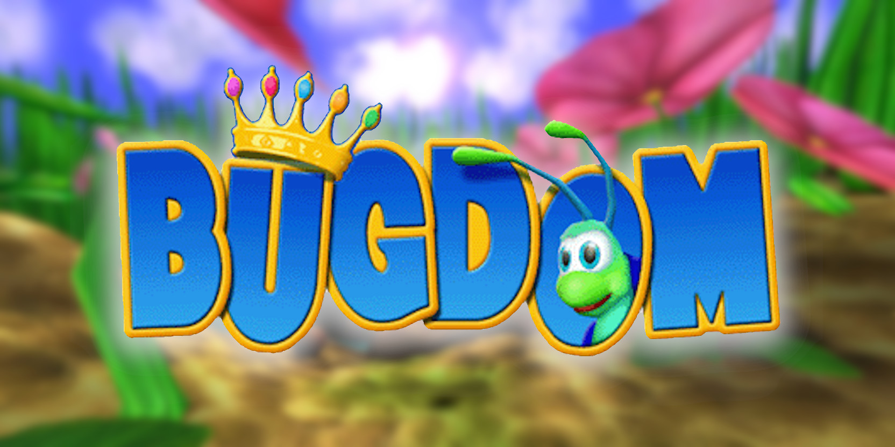
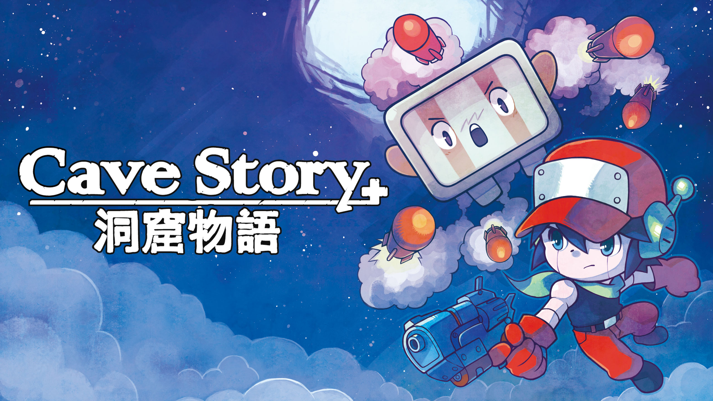
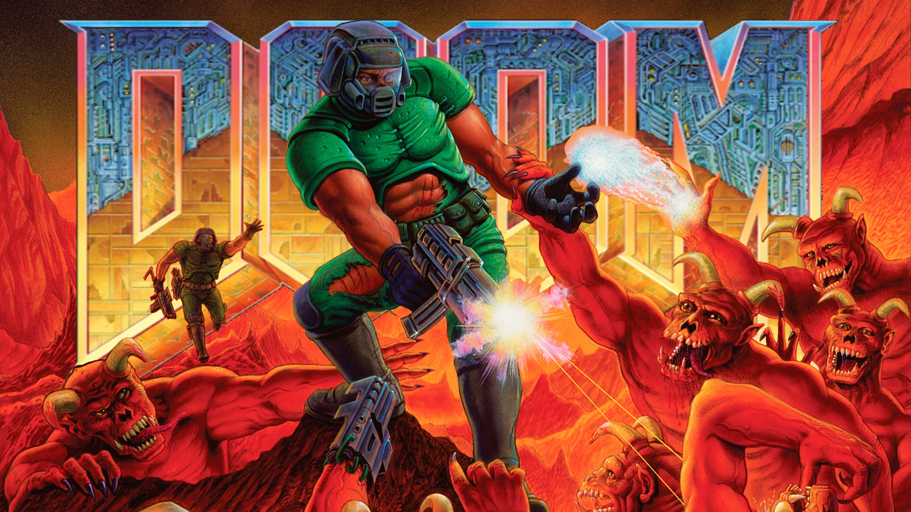
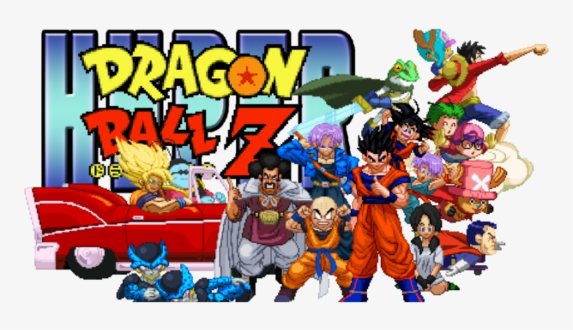
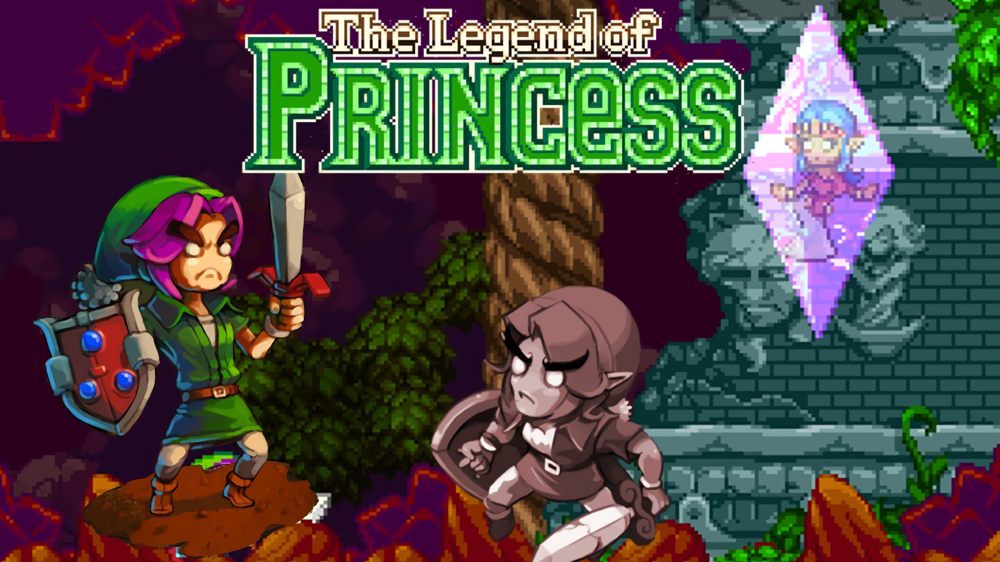
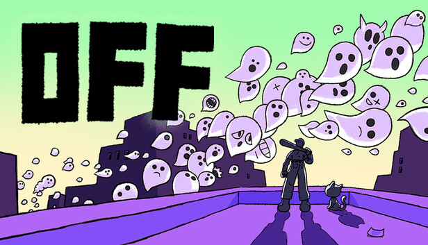
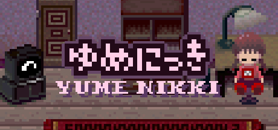
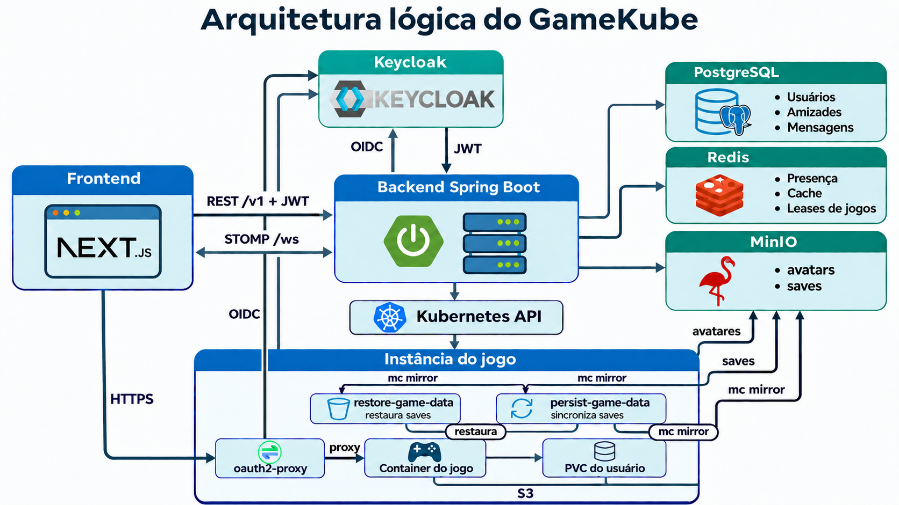

# GameKube

**GameKube is a Kubernetes-native platform for launching isolated game instances on demand and automatically managing their lifecycle.**

Players can browse a catalog of games and launch dedicated sessions on demand. GameKube runs each session in an isolated Kubernetes workload, monitors activity, and automatically cleans up idle instances. The platform also includes player profiles, game saves, friendships, live presence, and real-time messaging.

## 🎮 Explore the catalog

Browse a few games available on GameKube. Select a title to view its configuration.

|  |  |  |  |
|:---:|:---:|:---:|:---:|
| [](backend/src/main/resources/games/bugdom.yaml)<br>**Bugdom** | [](backend/src/main/resources/games/cavestory.yaml)<br>**Cave Story** | [](backend/src/main/resources/games/doom.yaml)<br>**DOOM** | [](backend/src/main/resources/games/hyperdbz.yaml)<br>**Hyper Dragon Ball Z** |
| [](backend/src/main/resources/games/loprincess.yaml)<br>**Legend of Princess** | [](backend/src/main/resources/games/off.yaml)<br>**OFF** | [](backend/src/main/resources/games/sonic-triple-trouble.yaml)<br>**Sonic Triple Trouble** | [](backend/src/main/resources/games/yume-nikki.yaml)<br>**Yume Nikki** |

## Features

- **On-demand game instances** — provision isolated game sessions in Kubernetes and automatically stop idle instances.
- **Game save management** — store and retrieve save backups using S3-compatible object storage.
- **Player accounts** — authenticate through Keycloak and manage profiles, avatars, and game history.
- **Social features** — find players, manage friendships, see online and in-game presence, and chat in real time.
- **Local Kubernetes environment** — deploy the platform dependencies to a local Kind cluster with Helm.

## Architecture



| Component | Technology | Purpose |
| --- | --- | --- |
| Frontend | Next.js, React, TypeScript | Web application and player experience |
| Backend | Java 21, Spring Boot | REST and real-time APIs, game lifecycle management |
| Orchestration | Kubernetes, Kind, Helm | Isolated game workloads and local infrastructure |
| Identity | Keycloak, OpenID Connect | Player authentication |
| Data and storage | PostgreSQL, Redis, MinIO | Application data, presence, and game saves |

The backend communicates with Kubernetes to manage game workloads. PostgreSQL stores application data, Redis supports real-time presence, and MinIO provides S3-compatible object storage for saves and avatars.

## Repository layout

```text
backend/                 Spring Boot API and game lifecycle management
frontend/                Next.js web application
infra/                   Kind configuration and Helm charts
docs/                    Architecture diagrams and project documentation
```

## Getting started

### Prerequisites

- Docker
- [Kind](https://kind.sigs.k8s.io/) and [Helm](https://helm.sh/)
- Java 21
- [Bun 1.3+](https://bun.sh/) (or Node.js 22+ with npm)

### 1. Start the local Kubernetes platform

From the repository root, run:

```bash
make -C infra up
```

This creates the `gamekube` Kind cluster and installs the platform and application dependencies with Helm. Check `infra/Makefile` and the Helm values under `infra/` for the deployment details.

### 2. Start the backend

Configure the backend environment, then start Spring Boot:

```bash
cp backend/.env.example backend/.env
```

Set the values in `backend/.env` to match your local cluster configuration, then run:

```bash
make -C backend up
```

The API listens on port `8000` by default. The backend startup target imports the local cluster CA into a Java trust store, so it requires `kubectl` and `keytool`.

### 3. Start the frontend

In a separate terminal:

```bash
cp frontend/.env.example frontend/.env.local
cd frontend
bun install
bun run dev
```

Open [http://localhost:3000](http://localhost:3000). Set the frontend environment values to match the backend and Keycloak URLs for your local setup. See [frontend/README.md](frontend/README.md) for the variable reference.

To stop the local Kind cluster, run `make -C infra down`.

## Development

Run repository formatting and static checks with:

```bash
make format
make check
```

Run the frontend browser tests with:

```bash
cd frontend
bun run test:e2e
```

The backend check target runs Spotless validation and unit tests. The frontend check target runs Prettier validation and ESLint.

## Documentation

- [Frontend development guide](frontend/README.md)
- [Software requirements specification (PDF)](docs/requirements/Documento_de_Requisitos_GameKube.pdf)
- [Architecture diagrams](docs/images/)
